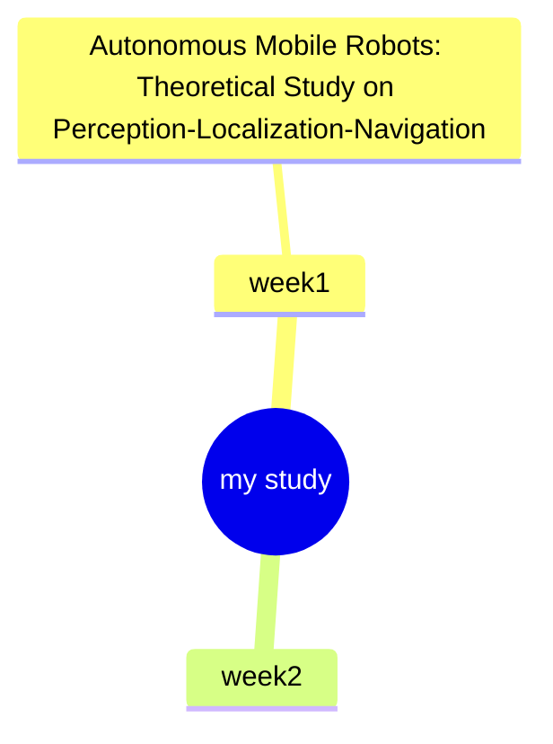

###week1
# Research on Autonomous Mobile Robot Perception, Localization and Navigation

> 
> This document records an independent self‑directed research endeavour aimed at broadening academic horizons within intelligent robotics. It synthesizes fundamental theories, system architectures, core functional modules and pertinent engineering toolchains for autonomous mobile robotic systems. Subsequent research phases will incorporate practical investigations including simulation validation, algorithmic benchmarking and hardware‑oriented deployment studies.

## Overview

Research on autonomous mobile robotics centres upon three fundamental research questions:

1. Where am I? — Localization
2. Where am I destined to go? — Mission specification and goal formulation
3. How can the target destination be attained? — Motion planning and navigation

To accomplish autonomous locomotion, a robotic system must possess an integrated suite of capabilities: environmental perception, environmental mapping, self‑pose estimation, motion planning and navigational execution.

### Definition of a Robot

A robot constitutes a physical machine satisfying the following defining attributes:

1. It resides within the three‑dimensional physical world and complies with fundamental physical laws;
2. It comprises movable mechanical assemblies formed by rigid links interconnected via joints;
3. It integrates actuators capable of generating physical motion outputs;
4. It is equipped with exteroceptive and proprioceptive sensors to perceive external surroundings and internal system states;
5. It embodies decision‑making faculties and may operate under fully‑autonomous, shared‑autonomy or manual‑supervised control paradigms;
6. It is capable of physically interacting with the real‑world environment to fulfil predefined operational objectives.

Two principal execution paradigms:

- **Open‑loop execution**: Operates according to pre‑programmed logic without environmental sensory feedback. This paradigm is applicable exclusively to deterministic, low‑perturbation operational scenarios.
- **Closed‑loop execution**: Dynamically modifies system behaviours leveraging feedback derived from both exteroceptive environmental sensors and proprioceptive on‑board sensors. The vast majority of autonomous robotic platforms adopt closed‑loop control.

Hierarchy of autonomy:

1. Manual control: All operational procedures are human‑executed.
2. Shared autonomy: Decision‑making responsibilities are partitioned between the robotic agent and human operator.
3. Full autonomy: Completes the complete sense‑think‑act pipeline without human intervention.

## Three Core Components: Sense — Think — Act
flowchart LR
    subgraph SENSE["🔍 Sense"]
        S1[Exteroceptive Sensors Camera / LiDAR / Ultrasonic / GPS]
        S2[Proprioceptive Sensors On‑board robot sensors]
        S3[Acquire raw sensory measurements]
        S4[Extract informative environmental features]
    end

    subgraph THINK["🧠 Think"]
        T1[Localization & Map‑Building]
        T2[State Estimation / Multi‑sensor Fusion]
        T3[Path Planning]
    end

    subgraph ACT["⚙️ Act"]
        A1[Path Execution]
        A2[Motion Control]
        A3[Actuators: motors, servos, rotors]
    end

    RW["🌍 Real‑World Environment"]

    SENSE --> THINK
    THINK --> ACT
    ACT --> RW
    RW --> SENSE

    style SENSE fill:#cce5ff
    style THINK fill:#fff2cc
    style ACT fill:#d5e8d4
    System closed‑loop mechanism:
Physical‑world observations are captured by sensors and fed into the perception module. Following data pre‑processing, localization and map construction, processed information propagates to the decision‑making module. Computed motion trajectories are dispatched to the execution module, which drives actuators to interact with the physical environment. Updated environmental observations are recursively fed back to sensors, establishing an iterative closed‑loop workflow.

## Full‑scale System Pipeline for Mobile Robots
flowchart TD
    Mission["🎯 Mission Command (High‑level Goal)"] --> PathPlan[Path Planning]

    Sensors["Exteroceptive & Proprioceptive Sensors"] --> Raw["Raw Sensor Readings"]
    Raw --> InfoExtract["Information Extraction"]
    InfoExtract --> LocalMap["Environment Model / Local Map"]
    LocalMap --> LocalMapBuild["Localization & Map Building"]

    LocalMapBuild -->|"Robot Pose + Global Map"| PathPlan

    PathPlan --> PathExec["Path Execution"]
    PathExec --> Control["Control Module"]
    Control --> Actuators["Actuator Command Output"]
    Actuators --> RealWorld["🌍 Real‑World Environment"]
    RealWorld --> Sensors

    style Sensors fill:#e1f5fe
    style LocalMapBuild fill:#f3e5f5
    style PathPlan fill:#fff8e1
    style Actuators fill:#e8f5e9
    Pipeline elaboration:

1. Exteroceptive and proprioceptive sensors collect raw observational data from the physical environment.
2. Raw measurements undergo information extraction for preliminary pre‑processing.
3. A local environmental model is constructed, while robot localization and map‑building are performed concurrently.
4. Estimated robot pose alongside the globally consistent environmental map are supplied to the path‑planning module, subject to high‑level mission constraints.
5. Planned trajectories are instantiated via motion‑control logic, transmitting control commands to system actuators.
6. The robot engages with the real‑world environment; environmental variations yield refreshed observations that are fed back to sensors to close the control loop.

## Two Distinct Technical Paradigms in Robotics Research
     flowchart LR
    subgraph ClassicalAI["📐 Classical AI: Model‑based Navigation (White‑box)"]
        S1[Sensors] --> Percep[Perception]
        Percep --> LM[Localization / Map‑Building]
        LM --> Cog[Cognition / Planning]
        Cog --> MotionCtrl[Motion Control]
        MotionCtrl --> Act1[Actuators]
    end

    subgraph ModernAI["🤖 Modern AI: Data‑driven Behaviour‑based Navigation (Black‑box)"]
        S2[Sensors] --> D1[Data communication]
        S2 --> D2[Environment exploration]
        S2 --> D3[Goal‑position detection]
        S2 --> D4[Obstacle avoidance]
        S2 --> D5[Wall‑following behaviour]
        D1 & D2 & D3 & D4 & D5 --> Fusion["Coordination & Fusion (e.g. Deep Learning)"]
        Fusion --> Act2[Actuators]
    end

    style ClassicalAI fill:#e8eaf6
    style ModernAI fill:#fce4ec
    - **Classical AI (Model‑driven, White‑box)**: Implements a serial modular pipeline: perception → localization & mapping → cognition & planning → motion control. This paradigm relies on explicitly hand‑formulated mathematical environmental models and affords high interpretability.
- **Modern AI (Data‑driven, Black‑box)**: Sensor inputs are distributed across multiple parallel task‑oriented sub‑modules. Task outputs are aggregated and fused (for instance via deep‑learning architectures), with minimal dependence on manually constructed analytical environment models.

## Core Research Modules

### 1. Robot Overview and Application Domains

Principal application domains:

- Industrial robots: Manipulator arms, welding manipulators, pick‑and‑place robotic systems. Characterized by high precision and repeatability; the majority are fixed‑base installations.
- Autonomous ground vehicles: Deployed for passenger transportation and logistics; tasked with obstacle detection and route generation.
- Unmanned Aerial Vehicles (UAVs): Applied for infrastructure inspection, agricultural manipulation, parcel delivery and post‑disaster emergency response.
- Service robots: Comprising cleaning robots, hospital logistics robots and security inspection robots, operating within domestic, clinical and office premises.
- Space robots: Designed for planetary exploration and on‑orbit satellite maintenance under extreme extraterrestrial conditions.
- Marine robots: Autonomous Underwater Vehicles (AUVs) and Remotely Operated Vehicles (ROVs) for deep‑sea exploration and offshore infrastructure inspection.
- Humanoid robots: Developed for factory automation and human‑robot collaborative scenarios.

Taxonomy of robotic platforms:

1. Manipulator / Articulated‑arm robots
2. Mobile robots (wheeled, aerial, marine)
3. Legged locomotion and humanoid robots
4. Social and medical robotic systems

### 2. Robot Pose, Coordinate Systems and Spatial Transformation

- Pose representation, spatial coordinate transformation, fundamentals of Lie Group theory
- Engineering implementation tool: ROS tf
- Prerequisite knowledge: Linear algebra

### 3. Robot Kinematics and Motion Models

- Robot kinematics
- Kinematic motion models for mobile robots

### 4. Robot Perception

- Operational principles of heterogeneous sensors
- Sensor error characteristics and sensor modelling
- Perception methodologies grounded in machine learning and deep learning

### 5. State Estimation and Multi‑sensor Fusion

- Bayesian filtering framework
- Kalman filter
- Particle filter
- The robot localization problem

### 6. Simultaneous Localization and Mapping (SLAM)

- Graph‑SLAM architectural framework
- SLAM front‑end and back‑end components
- LiDAR‑centric and radar‑centric SLAM approaches

### 7. Robot Vision

- Feature extraction and feature matching
- Sparse‑feature methodologies and direct methods
- Visual Odometry (VO)
- Visual SLAM

### 8. Autonomous Navigation

- Motion planning algorithms
- Obstacle‑avoidance strategies
- Navigation algorithms

### 9. Robot Learning and Research Frontiers

- Deep‑learning applications within robotic systems

## Development Toolchain and Academic Prerequisites

### Engineering Toolchain

- Docker container with ROS Noetic distribution
- EROS
- Gazebo multi‑physics simulation environment
- Programming languages: Python (preferred), C++

### Required Prior Knowledge

1. Programming proficiency: Competency in Python or C++
2. Mathematical background: Linear algebra, probability theory
3. Desirable competency: Linux command‑line operational proficiency

## References

1. Corke, P. *Robotics Vision and Control*. Springer.
2. Thrun, S., Burgard, W., & Fox, D. *Probabilistic Robotics*. MIT Press.
3. Govers III, F. X. *Artificial Intelligence for Robotics - Second Edition*. O'Reilly.
4. Pyo, Y., Cho, H., Jung, L., & Lim, D. *ROS Robot Programming*.

